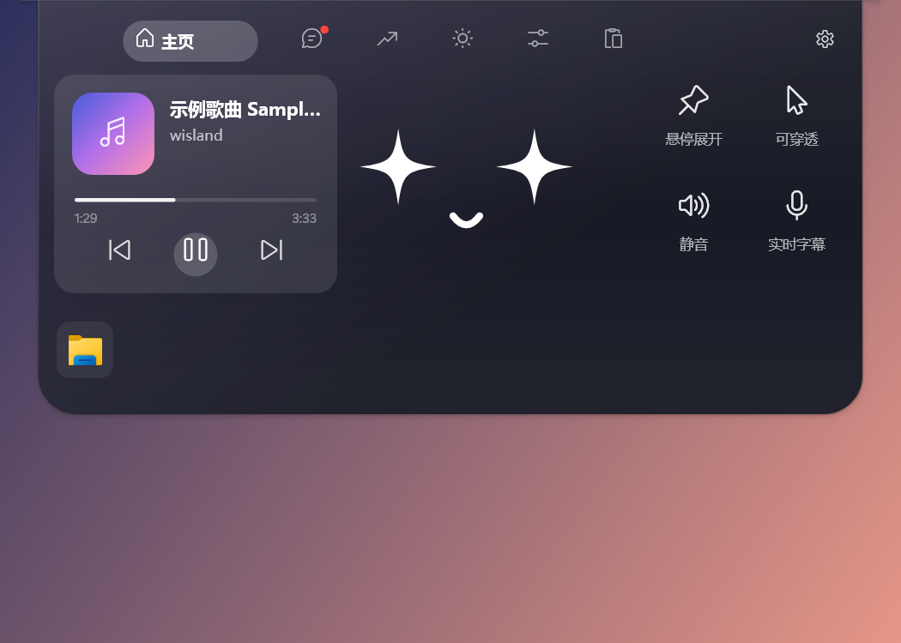
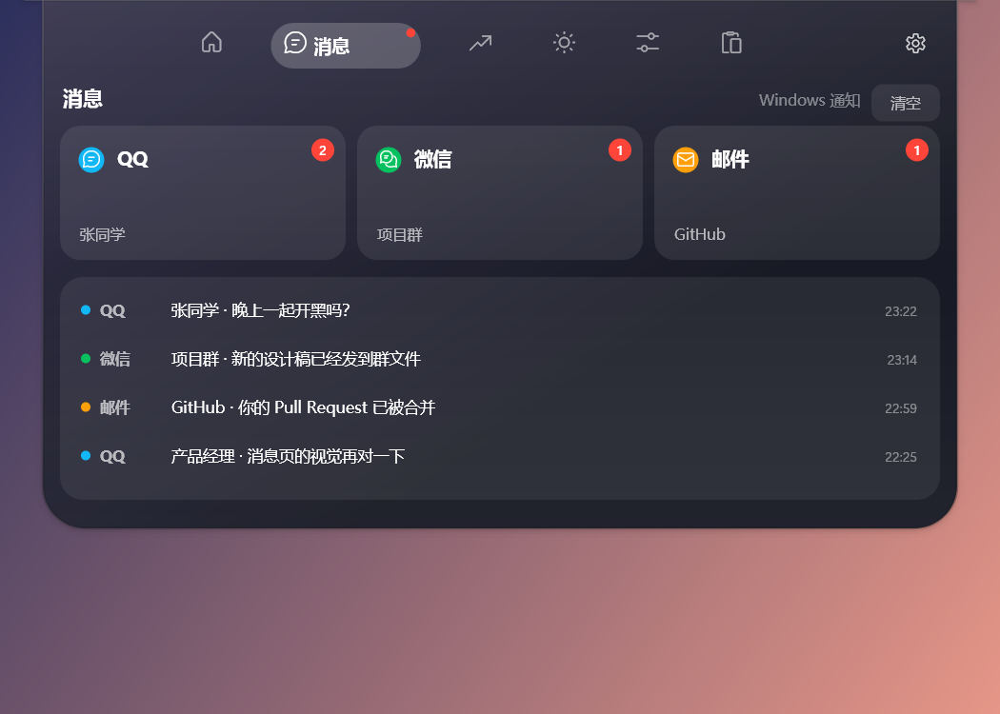

# Wisland Native

把 [AsamiAkito/wisland](https://github.com/AsamiAkito/wisland) 的液态灵动岛外观与核心交互，移植到
**C# / .NET 10 / WinForms + SkiaSharp** 的实现。目标不是套一层 WebView，而是走和
[NotchPeninsula](https://github.com/GEORGEWWWU/NotchPeninsula) 相近的原生路线：
Win32 透明分层窗口 + Skia 逐帧绘制。

> 当前是**第一版可运行移植**，不是 1:1 功能完全体。原项目约 1.2 万行 Python，
> 其中实时字幕、翻译、单词本/Anki、邮件、Clash 等属于独立的重模块，已明确列在下方“尚未迁移”。

## 预览






## 为什么改成 C#

- 去掉 Python + PySide6 + Qt 插件体系，常驻进程不再需要解释器和 Qt 运行时。
- 自绘窗口只创建一个小型 Win32 layered window，透明区域点击穿透。
- 默认使用静态渐变玻璃，不抓屏；需要真实桌面毛玻璃时把 `live_backdrop` 改成 `true`，才启用 1/4 分辨率、低频采样。
- 帧率分层：动画按显示器刷新率取整数分频（常见约 55–72 FPS），悬停/媒体约其一半，展开静止约 9–12 FPS，收起空闲约 4–5 FPS。
- 本机实测空载 CPU 约 **0.1~0.2%**、展开静止约 **0.3~0.4%**，工作集约 **90~105 MB**；原 Python 版通常更高，具体随 Qt/模型/插件变化。

## 性能模式

默认 `island.live_backdrop = false`：不抓取桌面，只画静态渐变玻璃。这样透明分层窗口不用持续做屏幕捕获、WPF/DWM 合成也不会被拖慢。需要真实桌面毛玻璃时再改成 `true`，它会以低分辨率、低频采样，CPU 和画面延迟都会明显增加。

动画使用高精度等待定时器按“下一帧截止时间”调度，并由显示器刷新率决定整数分频，避免 `16 ms` 粗粒度等待把 60 FPS 拖成不稳定的 30~45 FPS；165 Hz 等非 60 整数倍刷新率也会落在完整刷新周期上。

如果仍然觉得卡，优先确认没有把 `live_backdrop` 改成 `true`；其次可以把 `auto_cycle_s` 调大或设为 `0`，减少收起态自动轮换。

## 已实现

- 贴顶边液态胶囊：两侧表面张力肩线、底部大圆角、柔和阴影、玻璃描边。
- 收起态三种内容：时间天气 / 小形象 / 正在播放；滚轮切换，空闲自动轮换。
- 悬停展开、离开收起、双击“长关”、`Ctrl+Alt+I` 展开/收起。
- 展开面板：主页、消息、股票、天气、控制、剪贴板六个页签 + 右上角菜单。
- 主页：媒体封面/标题/进度/上一首/播放暂停/下一首、发光小形象、保持展开/可穿透/静音/实时字幕入口、应用启动器。
- 媒体：Windows SMTC（系统媒体传输控制），支持浏览器、QQ 音乐、Spotify、B 站等接入 SMTC 的播放器。
- 歌词：网易云公开接口按歌名/歌手/时长匹配 LRC，收起态显示当前歌词。
- 消息：只读 Windows 通知数据库，按 QQ / 微信 / 邮件分组；数据库不可用时监听任务栏窗口闪烁兜底。收起态未读小圆点、消息页计数与最近消息列表，点击唤起对应应用。

通知数据库路径是 `%LOCALAPPDATA%\Microsoft\Windows\Notifications\wpndatabase.db`。如果它不存在，先确认 Windows 通知已开启并实际收到过通知；任务栏闪烁兜底只要求在对应应用窗口闪动时保持程序运行。
- 天气：Open-Meteo（免 Key），当前天气、未来 24 小时、5 天预报。
- 股票：腾讯财经公开行情，自选列表来自配置。
- 控制：系统音量、静音、音频峰值律动、亮度（支持的显示器）、WLAN/蓝牙设置入口；音量与亮度滑条支持按住拖动。
- 剪贴板：最近 10 条文本，点击回填到剪贴板。
- 主题：自动 / 浅色 / 深色 / 胭脂撞色 / 晴空渐变。
- 托盘菜单：显示隐藏、主题、编辑配置、重新加载、退出。
- 配置编辑：内置 JSON 编辑器，保存前校验格式，保存后自动重新加载；不依赖 Windows Notepad。

## 尚未迁移

这些模块在 Python 版里各自依赖较大运行时或系统权限，第一版没有强行塞进来：

- 网易云本地播放日志（目前优先依赖 SMTC）
- 实时字幕（日语识别 + 翻译模型）、文本翻译、单词本、Anki 同步
- IMAP 邮件未读、Clash Verge 控制、股票搜索添加、天气城市管理 UI
- 拖拽拉丝/断开/吸附到任意边、多显示器选择、全屏自动隐藏
- Python 插件体系（wisland 原项目本身不是插件宿主）

## 构建

需要 **.NET 10 SDK**：

```powershell
dotnet build .\WislandSharp.csproj -c Release
```

发布单文件（框架依赖，目标机需 .NET 10 Desktop Runtime）：

```powershell
dotnet publish .\WislandSharp.csproj `
  -c Release -r win-x64 --self-contained false `
  -p:PublishSingleFile=true -p:IncludeNativeLibrariesForSelfExtract=true
```

运行：

```text
bin\Release\net10.0-windows10.0.19041.0\Wisland.exe
```

首次运行会在 exe 同目录生成 `config.json`。

## 配置

核心配置与 Python 版保持相近的字段名：

```json
{
  "island": {
    "theme": "auto",
    "expand_mode": "hover",
    "compact_view": "clock",
    "auto_cycle_s": 30,
    "show_idle_pet": true,
    "wheel_switch": true,
    "exclude_from_capture": false,
    "live_backdrop": false
  },
  "media": { "lyrics": true, "auto_show": true },
  "weather": { "city": "上海", "interval_min": 15 },
  "stocks": { "watchlist": ["sh000001", "sz399001", "hk00700", "usAAPL"] },
  "clipboard": { "max": 10 },
  "notify": {
    "enabled": true,
    "show_preview": true,
    "open": { "qq": "", "wechat": "", "mail": "" }
  },
  "launcher": [
    { "name": "文件资源管理器", "path": "C:/Windows/explorer.exe" }
  ]
}
```

- `expand_mode`: `hover` 悬停展开 / `always` 常驻展开 / `never` 保持收起。
- `compact_view`: `clock` / `pet` / `music`。
- `show_idle_pet`: 是否让“小形象表情”参与闲时自动轮换；关闭后闲时只保留时间天气，手动滚轮仍可切换。
- `wheel_switch`: 是否允许鼠标滚轮切换收起态视图或展开面板页签；关闭可避免误触。
- `exclude_from_capture`: `true` 时灵动岛不会出现在截图/录屏里；`false` 时抓背景会短暂排除自身。
- `live_backdrop`: 默认 `false`，使用轻量静态渐变玻璃，优先流畅；改成 `true` 才实时抓取桌面做真实毛玻璃。
- `notify.toast_apps`: 通知 Handler 的 PrimaryId 前缀到 QQ/微信/邮件的映射，默认已覆盖常见前缀。
- `notify.open`: 点击消息时优先启动的应用路径；留空则尝试唤起正在运行的 QQ/Weixin/Thunderbird 窗口。
- `notify.flash_processes`: 任务栏闪烁进程到 QQ/微信/邮件的映射；通知数据库不可用时用它兜底。
- 修改后可从托盘菜单“重新加载配置”，或重启程序。
- 如果系统自带 Notepad 提示 `Microsoft.UI.Windowing.Core.dll` 缺失，这是系统记事本 / WinUI 运行库的问题；Wisland 的“编辑配置”已经不再调用 Notepad，可直接使用内置编辑器。

## 快捷键

- `Ctrl+Alt+I`：展开 / 收起
- `Ctrl+Alt+M`：打开消息页
- `Ctrl+Alt+O`：打开内置配置编辑器
- `Ctrl+Alt+V`：打开剪贴板页
- `Ctrl+Alt+S`：保存当前 Skia 帧到 exe 同目录 `snapshot.png`（调试用）

## 结构

```text
WislandSharp/
├─ Program.cs                    应用上下文 / 托盘
├─ Native/
│  ├─ Win32.cs                   layered window / DIB / hotkey P/Invoke
│  └─ IslandWindow.cs            UpdateLayeredWindow 渲染循环与鼠标消息
├─ Core/
│  ├─ Config.cs                  config.json
│  ├─ Models.cs                  媒体/天气/股票/剪贴板模型
│  ├─ Shapes.cs                  液态胶囊路径
│  ├─ Theme.cs                   五套主题
│  └─ Backdrop.cs                低分辨率桌面抓取 + 模糊缓存
├─ Services/
│  ├─ MediaService.cs            Windows SMTC
│  ├─ LyricsService.cs           网易云 LRC
│  ├─ WeatherService.cs          Open-Meteo
│  ├─ StockService.cs            腾讯财经
│  ├─ SystemService.cs           音量/静音/峰值/亮度
│  └─ ClipboardService.cs        最近文本
└─ UI/
   ├─ IslandRenderer*.cs         收起态 / 展开面板 / 页面绘制与命中
   ├─ PetFace.cs                 发光双眼小形象
   └─ TextUtil.cs                字体与文本测量
```

## 说明

原项目 wisland 使用 MIT License。这个移植版保留相同的开源精神与署名要求；
原项目的视觉设计、交互思路与文案版权归原作者所有。
